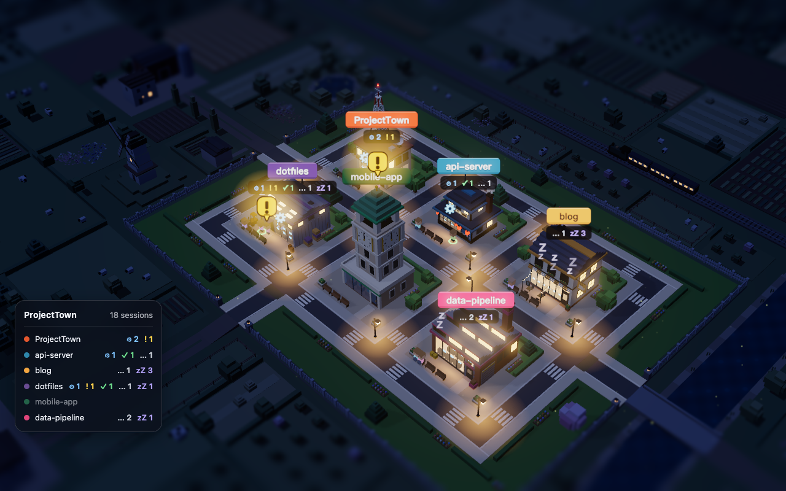
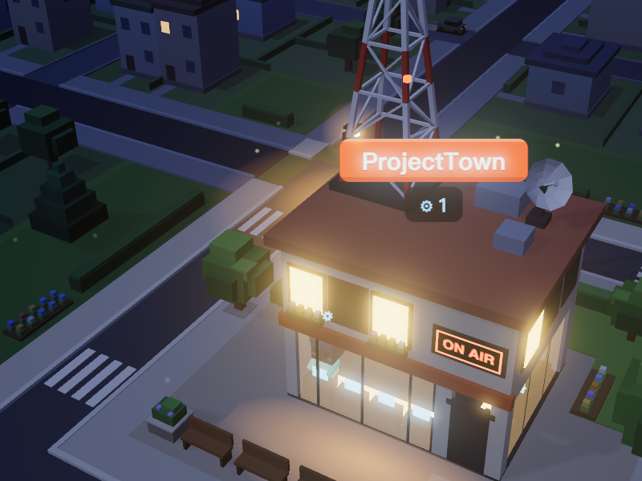
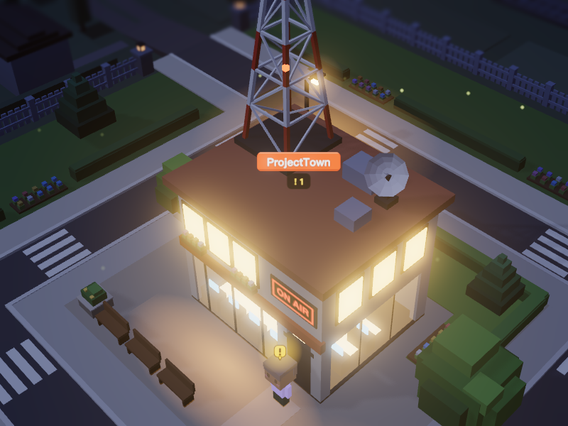
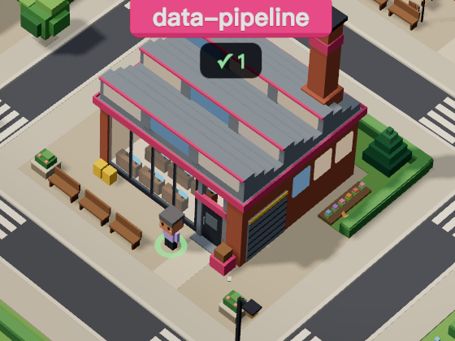
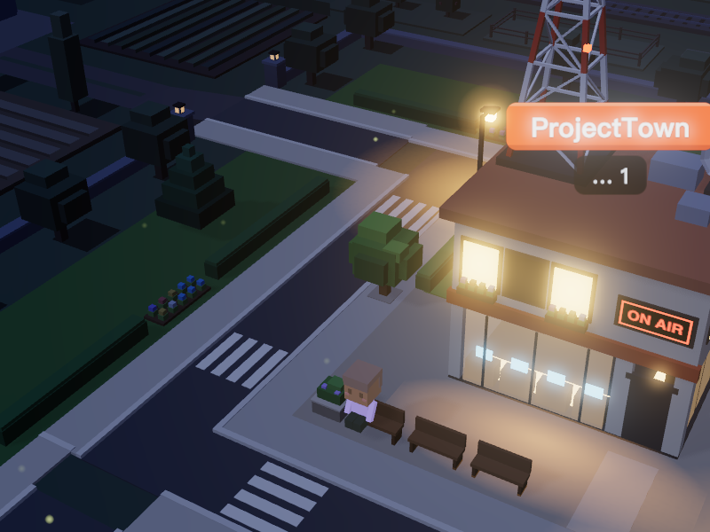
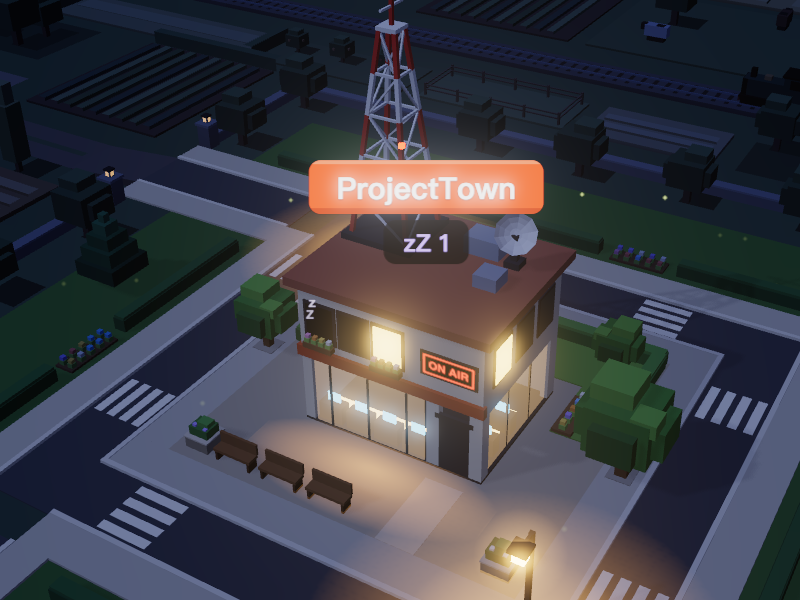
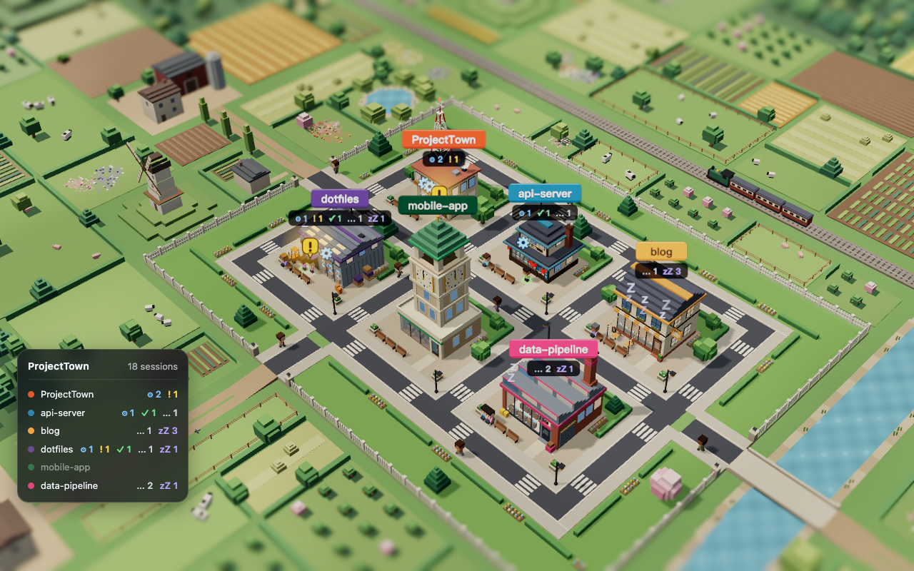

# ProjectTown

A macOS live wallpaper that turns your Claude Code sessions into a tiny voxel town.



**Supported languages: 繁體中文, English**

Each project folder you add becomes a building. Each Claude Code session working in that folder becomes a little person in front of it, and what the person does shows the session's state. You can see at a glance which project needs you.

## Features

**Five session states**

| | State | What you see |
|---|---|---|
|  | **Running** | Typing at a desk behind the shop window, with a spinning gear above the head. |
|  | **Needs you** | Standing at the door under a bouncing yellow "!" bubble, the brightest thing in town, day or night. |
|  | **Just finished** | A small burst of fireworks, then a green ring at the feet for 30 minutes (adjustable). |
|  | **Idle** | Sitting on the bench by the door, now and then stretching or looking around. |
|  | **Sleeping** | Idle for over 2 hours (adjustable): the person goes inside, one window goes dark and "zZ" drifts out. |

When a session ends, its person walks out to the road and off the map.

**The town**

- The town stands on a low terrace ringed by a white picket fence, in open countryside: meadows and pastures with grazing sheep, cottages and groves close by, patchwork fields further out, a river with two bridges, a small train that passes now and then, windmills, a few farms and hills all around, so the whole desktop is filled at any camera angle. Nothing out there has a sign or a person, so it is never mistaken for your projects.
- Prefer a city? Set the theme to **City** (Settings → Appearance) and the town sits in a varied neighbourhood instead: houses of many sizes, row houses, small apartment blocks, corner shops, a school, a church, parks and parking lots.
- Ten building styles (office, factory, café, bookstore, lab, warehouse, radio tower, greenhouse, clock tower, ramen shop), picked automatically or chosen per project, with your project color as an accent.
- A glowing sign above each building with the project name and per-state counts, plus "+N" when more people are inside than fit on screen.
- A HUD panel in the bottom-left corner with the session counts of every project. It is off by default; turn it on in Settings → Appearance.
- Session names and "last active" times above each person, hidden by default for privacy.

**Day and night**



- **Real time**: follows your clock, with your own sunrise and sunset (default 06:00 and 18:00).
- **Fixed cycle**: a full day every N minutes (5 minutes to 24 hours), with an adjustable share of daylight.

**Camera**

- **Fixed** (default), **Interval** (turns 90° every few minutes), or **Continuous** (a slow orbit, one turn per hour by default).
- **Adjust View** (menu bar or Settings): rotate, zoom and pan the town right on your desktop, then save.
- Depth-of-field blur for the miniature look: the scenery behind the town blurs more the farther away it is, and a band along the top and the bottom of the screen blurs too, with adjustable strength (25–200%, 60% by default) and range (0–45% of the screen height, 25% by default). The town itself always stays sharp. It can be turned off.
- **Show the town while switching desktops** (on by default): macOS sometimes shows the system wallpaper for a moment while you switch desktops or open Mission Control. With this option ProjectTown sets the system wallpaper to a recent snapshot of the town, so you see the town instead. Turning it off puts your own wallpaper back, and so does quitting, except when a full-screen app is in front: macOS then only lets ProjectTown reach that app's space, and your desktop keeps the last snapshot until ProjectTown runs again.

**Light on resources**

- Rendering pauses completely while the desktop is covered (for example by a full-screen app), while the screens sleep, and while you are switched to another user.
- Frame-rate limit: 15, 30 or 60 FPS (default 15).

## Requirements

- macOS 14 Sonoma or later
- [Claude Code](https://code.claude.com) — tested with version 2.1.308. Both the CLI and the desktop app are supported; cloud sessions are not shown.

## Install

1. Download `ProjectTown-vX.Y.Z.zip` from [Releases](https://github.com/KevinYu1580/ProjectTown/releases) and unzip it.
2. Drag `ProjectTown.app` to `/Applications`.
3. The app is ad-hoc signed and not notarized, so macOS blocks it the first time. Remove the quarantine attribute:

   ```bash
   xattr -dr com.apple.quarantine /Applications/ProjectTown.app
   ```

   Or right-click the app in Finder and choose **Open**.

## Usage

1. Open ProjectTown. A house icon appears in the menu bar; the app has no Dock icon.
2. Choose **Open Settings…** from the menu bar icon.
3. In **Projects**, click **+** and pick your project folders. Each folder becomes a building. Any Claude Code session whose working directory is inside a project folder, including worktrees in subfolders, shows up there.
4. That's it — the "Needs you" state works out of the box, no hooks or setup needed.

The menu bar menu also has **Adjust View**, **Pause Rendering** and **Reload Scene**. In Settings you can change the day/night mode, camera, display, frame rate and state durations, and turn on **Launch at login**.

## How it works

ProjectTown reads `~/.claude/sessions/*.json` once a second. Claude Code keeps one file there for each running session, with its working directory, status and name.

- Each session goes to the project whose folder contains its working directory; the deepest matching folder wins.
- The process ID in the file is checked to make sure the session is still running. The process start time is compared too, so a reused process ID is not mistaken for an old session.
- The file's `status` drives the character: `busy` is Running, and `waiting` is Needs you. Claude Code sets `waiting` while it waits for you, for example at a permission prompt. `idle` shows as Just finished for a while after the session did some work, then Idle, then Sleeping.

No hooks are needed, and ProjectTown never writes to `~/.claude`.

> **Warning:** `~/.claude/sessions` is an undocumented internal format of Claude Code. A Claude Code update may change it and stop ProjectTown from seeing your sessions.

## Privacy

- Everything happens on your Mac. ProjectTown makes no network connections.
- It reads only `~/.claude/sessions/*.json` (session ID, working directory, status, name and timestamps) and its own settings file. It never reads your conversations, prompts or transcripts, and it never writes to `~/.claude`.
- Session names are hidden on the wallpaper by default (Settings → Status → Hide session names).
- Settings are stored in `~/Library/Application Support/ProjectTown/config.json`. Wallpaper snapshots, and a note of the wallpaper each desktop had before, are kept in `~/Library/Application Support/ProjectTown/Wallpaper/`. Snapshots of a desktop or display that has not been seen for a week are deleted.

## Known limitations

- `~/.claude/sessions` is an undocumented Claude Code format; a Claude Code update may break session reading.
- Other live-wallpaper apps draw at the same desktop level and conflict with ProjectTown. Quit them first.
- The town is shown on one display (selectable in Settings).
- WKWebView renders at most about 60 frames per second, so there is no 120 FPS option.
- The app is not notarized (see [Install](#install)).

## Build from source

Requirements: Xcode 16 or later for Swift 6 (developed and tested with Xcode 27.1), Node.js LTS (developed with Node 22), and [XcodeGen](https://github.com/yonaskolb/XcodeGen) (`brew install xcodegen`).

```bash
make app
```

This builds the web scene, generates the Xcode project, builds a Debug app into `build/ProjectTown.app` and opens it.

## Development

- `make dev` starts the scene in a browser at http://localhost:5173 in **mock mode**, with fake sessions and a lil-gui control panel to switch states, time of day, camera and settings. URL parameters:
  - `scenario`: `empty`, `single`, `busy` (default), `crowded`, `many`, `unnamed`, `gallery` (all ten building styles), `nodata` (session files unreadable)
  - `lang`: `en` or `zh-Hant`
  - `time`: epoch milliseconds; freezes the scene at that moment (used for reproducible screenshots)
  - `seed`: random seed for the mock data
  - `gui=0`: hide the control panel
- `make check` runs every check that CI runs: typecheck, lint, unit tests (Vitest), e2e tests (Playwright), `swift test` and an Xcode build. Run it before every commit.
- The app accepts two development environment variables: `PROJECTTOWN_WEB_URL` loads the scene from a URL (e.g. the dev server) instead of the bundle, and `PROJECTTOWN_MEASURE_RAF=1` prints the scene's measured frame rate.

Project structure:

```
app/                      Swift app: wallpaper window, menu bar, settings window
Packages/ProjectTownCore/ Swift package: session reading, state derivation, config (unit tested)
web/                      Three.js scene (TypeScript, Vite), mock mode, tests
docs/screenshots/         README images
project.yml               XcodeGen project definition
```

## Contributing

CI runs on GitHub Actions (`.github/workflows/ci.yml`): a `web` job (typecheck, lint, unit tests, e2e) and a `swift` job (`swift test`, `xcodegen`, `xcodebuild build`). Two limitations apply while the repository is private:

1. **Actions minutes quota.** Private repositories get a monthly free quota of Actions minutes (2000), and macOS runners are billed at 10x. To save minutes, the `swift` job only runs when Swift-related files change (`app/**`, `Packages/**`, `project.yml`, `Makefile`, `.github/workflows/**`).
2. **No branch protection.** GitHub Free private repositories cannot enforce branch protection or rulesets, so "CI must pass before merge" is enforced by convention: wait for green CI before merging your own PR. Once the repository is public, branch protection on `main` will require both the `web` and `swift` checks to pass.

## Disclaimer

ProjectTown is an independent project and is not affiliated with, endorsed by, or sponsored by Anthropic. Claude is a trademark of Anthropic.

## License

MIT. See [LICENSE](LICENSE).
