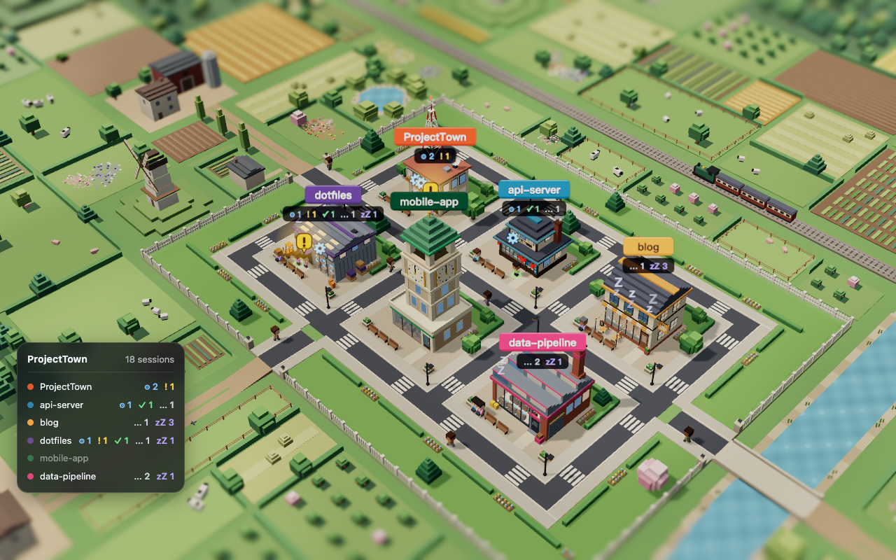
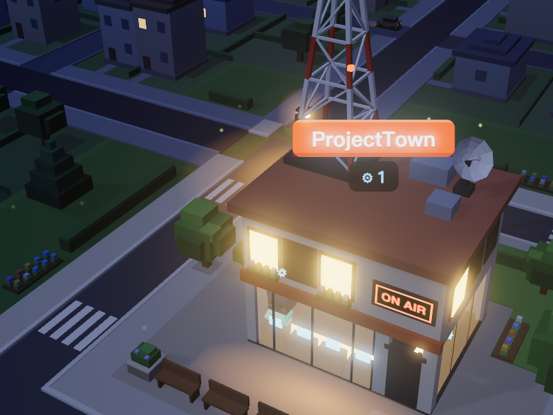
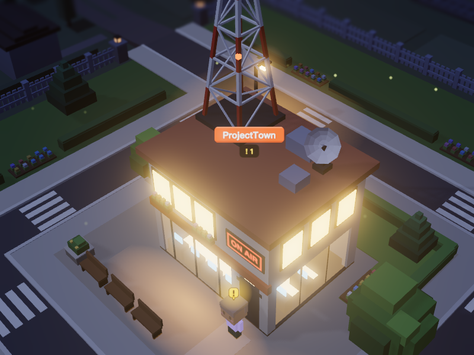
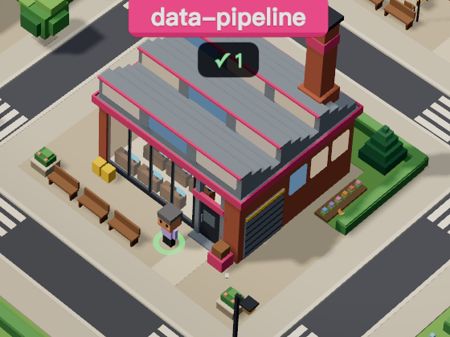
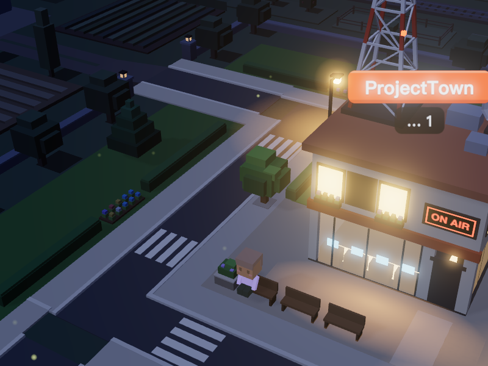
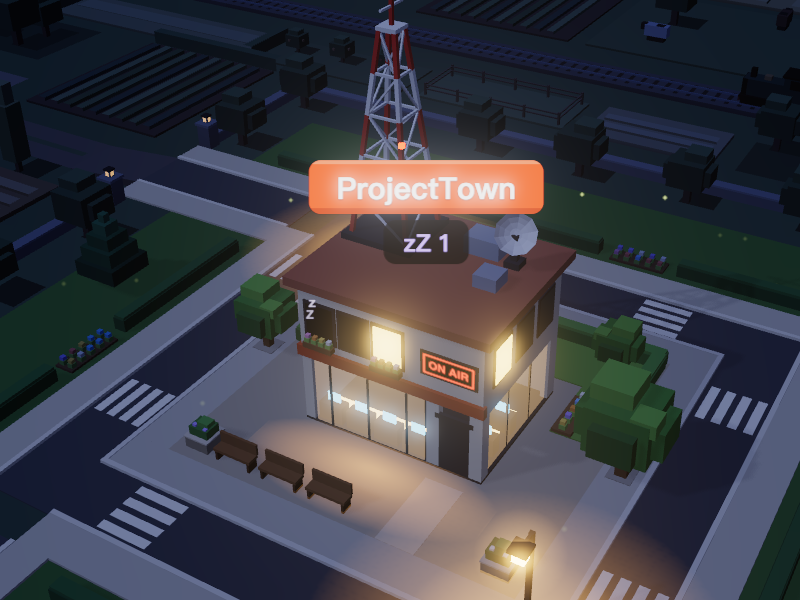
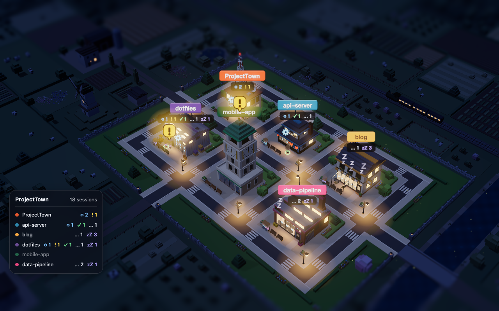

# ProjectTown

[English](README.md) | **繁體中文**

> [!TIP]
> **☕ 贊助 ProjectTown**
>
> ProjectTown 完全免費且開源，沒有付費版。如果它讓你的桌面多了點樂趣，歡迎[到 Ko-fi 請我喝杯咖啡](https://ko-fi.com/kevinyu1580)，支持小鎮繼續長大。menubar 選單和設定 → 一般裡也找得到這個連結。
>
> [](https://ko-fi.com/kevinyu1580)

把你的 Claude Code session 變成一座 voxel 小鎮的 macOS 動態桌布。



**支援語言：繁體中文、English**（跟隨 macOS 語言，見[語言](#語言)）

你加入的每個專案資料夾都會變成一棟建築；在該資料夾裡工作的每個 Claude Code session 都會變成建築前的一個小人，小人在做什麼就代表 session 的狀態。哪個專案在等你，一眼就看得出來。

## 功能

**五種 session 狀態**

| | 狀態 | 畫面 |
|---|---|---|
|  | **執行中** | 坐在店面櫥窗後的桌前打字，頭上有個轉動的齒輪。 |
|  | **等你回應** | 站在門口，頭上有個跳動的黃色「!」泡泡，不分日夜都是全鎮最亮的東西。 |
|  | **剛完成** | 先放一小束煙火，之後腳下出現綠色光圈，持續 30 分鐘（可調）。 |
|  | **閒置** | 坐在門邊的長椅上，偶爾伸懶腰或東張西望。 |
|  | **睡著** | 閒置超過 2 小時（可調）：小人回到屋裡，一扇窗熄燈並飄出「zZ」。 |

session 結束時，小人會走到馬路上，離開畫面。

**小鎮**

- 小鎮坐落在白色木柵欄圍起的矮台地上，四周是開闊的田園：羊、牛、豬邊吃草邊漫步的草地與牧場，附近有小屋和樹林，遠一點是拼布般的農田，還有一條架著兩座橋的河、偶爾經過的小火車、風車、幾座農場和環繞的山丘，不論攝影機轉到哪個角度都能填滿整個桌面。郊外的東西都沒有招牌。有幾個路人會在小鎮裡散步，也會穿過柵欄門走到農場；他們長得和你的小人一樣，但穿的是暗淡的衣服而不是粉嫩色，沒有名字也沒有符號，晚上會回屋裡，所以不會被誤認成你的 session。
- 比較喜歡都市？把主題設成 **都會**（設定 → 外觀），小鎮就會改坐落在多樣的住宅區裡：各種大小的房子、連棟住宅、小型公寓、街角商店、學校、教堂、公園和停車場，街上有車流，人行道上有行人，在小鎮和周邊街區之間來往。
- 十種建築款式（辦公大樓、工廠、咖啡店、書店、實驗室、倉庫、電台塔、溫室、鐘樓、拉麵店），可自動挑選或逐一指定，並以專案顏色點綴。
- 每棟建築上方有發光招牌，顯示專案名稱與各狀態的人數；屋裡的人多到畫面放不下時，會再顯示「+N」。
- 左下角的 HUD 面板顯示每個專案的 session 統計。預設關閉，可在 設定 → 外觀 開啟。
- 小人頭上可顯示 session 名稱與「最後活動」時間，為了隱私預設隱藏。

**日夜**



- **真實時間**：跟著你的時鐘走，可自訂日出與日落時間（預設 06:00 與 18:00）。
- **固定循環**：每 N 分鐘（5 分鐘到 24 小時）走完一天，白天比例可調。

**攝影機**

- **固定**（預設）、**定時環繞**（預設每 10 分鐘轉 90°）或 **緩慢環繞**（緩慢繞圈，預設一小時一圈）。
- **調整視角**（menubar 或設定）：直接在桌面上旋轉、縮放、平移小鎮，或從四個預設視角中挑一個，再按 **完成**。
- 營造微縮模型感的景深模糊：小鎮後方的景物越遠越模糊，畫面上下兩條帶狀區域也會模糊；強度（25–200%，預設 60%）與範圍（畫面高度的 0–45%，預設 25%）可調。小鎮本身永遠清晰。可以關閉。
- **切換桌面時顯示小鎮**（預設開啟）：切換桌面或開啟指揮中心時，macOS 有時會短暫露出系統桌布。開啟此選項後，ProjectTown 會把小鎮所在螢幕的每個桌面一次換成最近一次的小鎮截圖，讓你看到的是小鎮，連還沒切過去的桌面也一樣。動態桌布和空拍桌布也適用。關閉此選項會換回你原本的桌布（包括動態和空拍桌布），結束 app 時也會。鎖定畫面也會顯示小鎮，所以鎖定和解鎖時畫面不會切換。快照只有 3D 小鎮，沒有招牌、名稱和狀態符號，所以鎖定畫面不會露出你的專案名稱或 session 的狀態。為了一次處理所有桌面，ProjectTown 會修改 macOS 自己的桌布設定（`~/Library/Application Support/com.apple.wallpaper/Store/Index.plist`）並重啟系統的桌布程式，所以這時所有螢幕的桌布會重畫一次。如果未來的 macOS 改了這個檔案，ProjectTown 會退回只處理目前的桌面。
  若你同時使用其他會自動更換桌布的工具（動態或影片桌布 app、輪播桌布，包括系統設定裡的自動輪播、捷徑或腳本自動化），請不要讓它們管理小鎮所在的螢幕，或關閉此選項。兩邊會輪流改寫同一個系統桌布，結果可能露出錯的桌布，ProjectTown 換回的「原本桌布」也可能不是你要的那張。ProjectTown 只記得當時顯示的那一張圖，所以輪播桌布換回後不會繼續輪播。

**省資源**

- 桌面被遮住（例如全螢幕 app）、螢幕休眠、或切換到其他使用者時，渲染完全暫停。
- 幀率上限：15、30 或 60 FPS（預設 15）。

## 系統需求

- macOS 14 Sonoma 或更新版本
- [Claude Code](https://code.claude.com) — 已用 2.1.308 版測試。CLI 與桌面版都支援；cloud session 不會顯示。

## 安裝

1. 從 [Releases](https://github.com/KevinYu1580/ProjectTown/releases) 下載 `ProjectTown-vX.Y.Z.zip` 並解壓縮。
2. 把 `ProjectTown.app` 拖到 `/Applications`。
3. 這個 app 是 ad-hoc 簽章、未經公證，所以第一次開啟會被 macOS 擋下。請移除隔離屬性：

   ```bash
   xattr -dr com.apple.quarantine /Applications/ProjectTown.app
   ```

   或在 Finder 對 app 按右鍵，選擇 **打開**。

### 更新

上面的步驟只要做一次。ProjectTown 每天會到 GitHub 檢查一次新版本；有新版時，從 menubar 選單選擇 **有新版本！安裝並重新啟動**，或在設定 → 一般按 **更新並重新啟動**。它會下載新版、驗證簽名、把舊版移到垃圾桶並重新啟動，你不用自己下載，也不用處理隔離屬性。想手動更新的話，可以在設定 → 一般關閉 **自動檢查更新**。1.4.0 之前的版本無法自己更新，請手動安裝一次 1.4.0。

## 使用方式

1. 開啟 ProjectTown。menubar 會出現房子圖示；這個 app 沒有 Dock 圖示。
2. 從 menubar 圖示選擇 **開啟設定…**。
3. 在 **專案** 按 **+**，選擇你的專案資料夾。每個資料夾會變成一棟建築。只要 Claude Code session 的工作目錄在專案資料夾底下（包括子資料夾裡的 worktree），就會出現在那棟建築。
4. 這樣就好了 —「等你回應」狀態開箱即用，不需要 hooks 或任何設定。

menubar 選單另有 **調整視角**、**暫停渲染**、**重新載入場景** 與 **贊助 ProjectTown…**。

## 客製化選項

以下選項都在 **開啟設定…** 裡，改了立即生效。

**專案**

- **+** / **−**：新增專案資料夾（可一次選多個）或移除所選專案。在清單中拖曳專案可調整小鎮裡建築的順序。
- 每個專案可設定：**名稱**（顯示在招牌上）、**顏色**（建築點綴色與招牌顏色）與 **建築款式**（**自動** 依資料夾路徑挑選，或指定十種款式之一）。

**外觀**

| 設定 | 選項 | 預設 |
|---|---|---|
| 日夜 → 模式 | **真實時間** 或 **固定循環** | 真實時間 |
| 日出／日落（真實時間） | 任意時間；日落須晚於日出 | 06:00／18:00 |
| 週期長度（固定循環） | 5–1440 分鐘 | 60 分鐘 |
| 白天比例（固定循環） | 10–90% | 50% |
| 攝影機 → 模式 | **固定**、**定時環繞**、**緩慢環繞** | 固定 |
| 每隔（定時環繞） | 1–60 分鐘 | 10 分鐘 |
| 繞一圈需要（緩慢環繞） | 2–60 分鐘 | 60 分鐘 |
| 視角 | **調整視角…**／**重設視角** | — |
| 主題 | **田園** 或 **都會** | 田園 |
| 景深模糊 | 開／關 | 開 |
| 模糊強度 | 25–200% | 60% |
| 模糊範圍 | 畫面高度的 0–45% | 25% |
| 顯示 HUD | 開／關 | 關 |
| 螢幕 | 任一已連接的螢幕 | 主螢幕 |
| FPS | 15、30、60（120 會顯示但無法選） | 15 |
| 切換桌面時顯示小鎮 | 開／關 | 開 |

**狀態**

| 設定 | 選項 | 預設 |
|---|---|---|
| 「剛完成」持續 | 1–240 分鐘 | 30 分鐘 |
| 睡著門檻 | 10–1440 分鐘，須比「剛完成」長 | 120 分鐘 |
| 隱藏 session 名稱 | 開／關 | 開 |

**一般**

- **開機時自動啟動**（macOS 可能要求你到 系統設定 → 登入項目 允許）。
- **暫停渲染**，與 menubar 的開關相同。
- **自動檢查更新**（預設開啟），也可以按 **立即檢查** 馬上查看。見[更新](#更新)。

### 語言

ProjectTown 本身沒有語言設定，和大多數 Mac app 一樣跟隨 macOS：偏好語言的第一順位是繁體中文時顯示繁體中文，否則顯示英文。若只想讓 ProjectTown 使用其他語言，請到 系統設定 → 一般 → 語言與地區 → 應用程式，加入 ProjectTown 並選擇語言，然後結束再重新開啟 app。

## 運作方式

ProjectTown 每秒讀取一次 `~/.claude/sessions/*.json`。Claude Code 會為每個執行中的 session 在那裡保留一個檔案，記錄工作目錄、狀態與名稱。

- 每個 session 歸屬於資料夾包含其工作目錄的專案；有多個符合時，取最深的資料夾。
- 會檢查檔案裡的 process ID，確認 session 仍在執行；也會比對 process 啟動時間，避免把重複使用的 process ID 誤認成舊 session。
- 檔案的 `status` 決定小人的狀態：`busy` 是執行中，`waiting` 是等你回應。Claude Code 在等你的時候（例如權限確認）會設成 `waiting`。`idle` 在 session 做完事後的一段時間內顯示為剛完成，之後是閒置，再來是睡著。

不需要 hooks，ProjectTown 也從不寫入 `~/.claude`。

> **警告：** `~/.claude/sessions` 是 Claude Code 未公開的內部格式。Claude Code 更新後可能改變格式，讓 ProjectTown 看不到你的 session。

## 隱私

- 一切都在你的 Mac 上進行。唯一的網路連線是檢查更新：ProjectTown 每天向 GitHub 查詢一次最新版本（`api.github.com`），你選擇更新時才從 GitHub 下載。不會傳送任何關於你或你的 session 的資料。可在設定 → 一般關閉。
- 只讀取 `~/.claude/sessions/*.json`（session ID、工作目錄、狀態、名稱與時間戳記）和自己的設定檔。從不讀取你的對話、提示或逐字紀錄，也從不寫入 `~/.claude`。
- 桌布上的 session 名稱預設隱藏（設定 → 狀態 → 隱藏 session 名稱）。
- 設定存放在 `~/Library/Application Support/ProjectTown/config.json`。桌布截圖，以及每個桌面原本桌布的紀錄，存放在 `~/Library/Application Support/ProjectTown/Wallpaper/`。開啟 **切換桌面時顯示小鎮** 時，ProjectTown 也會修改 macOS 桌布設定（`~/Library/Application Support/com.apple.wallpaper/Store/Index.plist`）裡的桌布項目，不動檔案裡的其他內容。超過一週沒出現的桌面或螢幕，其截圖會被刪除。

## 已知限制

- `~/.claude/sessions` 是 Claude Code 未公開的格式；Claude Code 更新可能讓 session 讀取失效。
- 其他動態桌布 app 會畫在同一個桌面層級，與 ProjectTown 衝突，請先結束它們。
- 小鎮只顯示在一台螢幕上（可在設定中選擇）。
- WKWebView 最多約每秒 60 幀，所以 120 FPS 選項是灰色的。
- 這個 app 未經公證（見[安裝](#安裝)）。

## 從原始碼建置

需求：Xcode 16 以上以支援 Swift 6（開發與測試使用 Xcode 27.1）、Node.js LTS（開發使用 Node 22），以及 [XcodeGen](https://github.com/yonaskolb/XcodeGen)（`brew install xcodegen`）。

```bash
make app
```

這會建置 web 場景、產生 Xcode 專案、把 Debug 版 app 建置到 `build/ProjectTown.app` 並開啟。

## 參與貢獻

變更只能透過 pull request 進入 `main`，不能直接推送。開 PR 前請先跑 `make check`。

CI 跑在 GitHub Actions（`.github/workflows/ci.yml`）：`web` job（typecheck、lint、單元測試、e2e）與 `swift` job（`swift test`、`xcodegen`、`xcodebuild build`）。`swift` job 只在 Swift 相關檔案變更時執行（`app/**`、`Packages/**`、`project.yml`、`Makefile`、`.github/workflows/**`）。

搬到這個 repo（2026-11-08）之前的 pull request 保存在 [docs/pull-requests-archive.md](docs/pull-requests-archive.md)。

## 免責聲明

ProjectTown 是獨立專案，與 Anthropic 沒有關聯，也未獲其背書或贊助。Claude 是 Anthropic 的商標。

## 授權

MIT。見 [LICENSE](LICENSE)。
